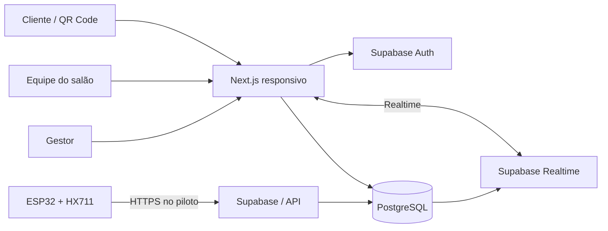

# Arquitetura da solução

## Visão lógica

## Camadas

- **Apresentação:** Next.js, React e TypeScript. Interfaces responsivas para cliente, equipe e gestão.
- **Identidade:** Supabase Auth ou JWT, com perfis de garçom, limpeza e gestor.
- **Persistência:** PostgreSQL. O Supabase pode fornecer banco, autenticação e recursos realtime no piloto.
- **Serviços:** a proposta prevê NestJS quando regras de negócio mais complexas justificarem uma API dedicada.
- **Dispositivo:** ESP32 com HX711, firmware em C/C++ via Arduino/PlatformIO.

## Fluxo de pesagem

1. O HX711 fornece amostras à taxa de referência de 10 leituras por segundo.
2. O ESP32 aplica tara/calibração e observa uma janela de estabilidade de aproximadamente 1,5 a 3 segundos.
3. Variações abaixo do limiar são ignoradas; pequenas retiradas acumulam em relação ao último peso registrado.
4. Aumento grande e estável é classificado como reposição.
5. No piloto, o envio é por HTTPS. Se a conectividade cair, o dispositivo deve guardar eventos localmente e sincronizar depois.
6. MQTT pode ser avaliado se a quantidade de sensores crescer.

Os valores iniciais de referência (20–50 g de limiar e cerca de 5 g de variação dentro da janela) precisam ser ajustados durante o piloto.

## Segurança

- Nunca exponha a chave Supabase Service Role no navegador.
- O dispositivo deve autenticar suas requisições; não aceite eventos sem validação de origem.
- Aplique autorização por perfil nas operações administrativas.
- Use HTTPS em trânsito e segredos em variáveis de ambiente.
- A tabela `funcionario` guarda o vínculo com a identidade autenticada; a autenticação fica a cargo do serviço de identidade.

## Limites da medição

A balança registra a variação de peso da cuba. Não identifica quem retirou o alimento nem comprova que ele chegou ao prato. Descarte, queda, pegador apoiado e contato com a travessa podem afetar a leitura. Reposição deve ser registrada separadamente.
